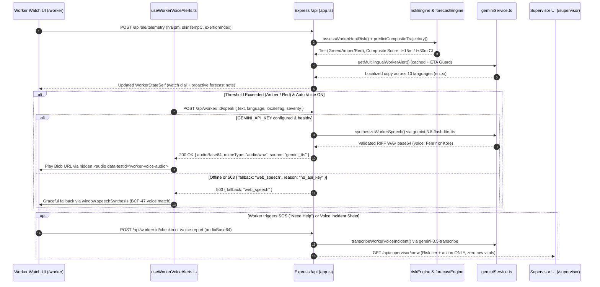
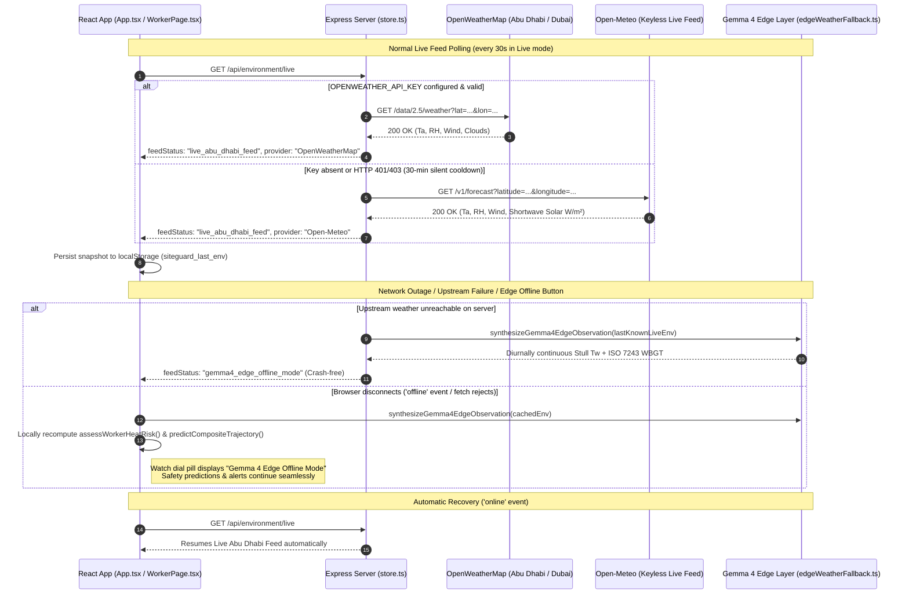
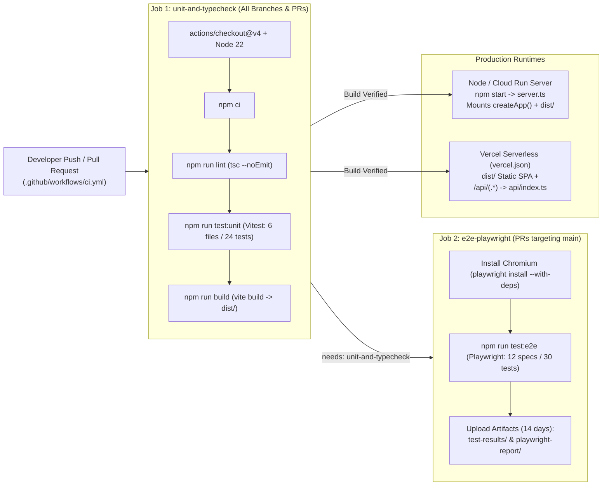

<div align="center">

# SiteGuard

### Climate-Resilient Worker Health, Multilingual Cloud Voice Alerts & UAE Midday Compliance Platform

[](tsconfig.json)
[](package.json)
[](server.ts)
[](src/server/geminiService.ts)
[](TESTING.md)
[](vercel.json)

**Team:** GenOS Team · **Region Focus:** Abu Dhabi & Dubai, UAE · **Standard Alignment:** Moran PSI, ACGIH TLV/CAF, ISO 7243 WBGT & UAE Ministerial Resolution No. 44 of 2022

</div>

---

> [!IMPORTANT]
> **Deterministic Safety First, Hybrid AI for Human Equity:**
> SiteGuard isolates **100% of numeric heat-strain calculations, threshold crossings, and `t+15m`/`t+30m` forecasts** inside pure deterministic TypeScript engines (`riskEngine.ts`, `forecastEngine.ts`). Gemini models are strictly used for **plain-language worker explainability**, **10-core + 114-global language translation**, **authentic server-side Cloud TTS audio**, **audio incident transcription**, and **executive compliance/backtest narratives**—guarded by server-side ETA hallucination checks and API-level vitals redaction.

---

## Table of Contents

1. [Why SiteGuard?](#why-siteguard)
2. [System Architecture Diagram](#system-architecture-diagram)
3. [End-to-End Alert, Cloud TTS & Supervisor Escalation Flow](#end-to-end-alert-cloud-tts--supervisor-escalation-flow)
4. [Real-Time Weather & Gemma 4 Edge Offline Failover Flow](#real-time-weather--gemma-4-edge-offline-failover-flow)
5. [GitHub CI/CD & Deployment Pipeline Flow](#github-cicd--deployment-pipeline-flow)
6. [Platform Modules & Feature Highlights](#platform-modules--feature-highlights)
7. [Wearable Alert Telemetry States & Multilingual Matrix](#wearable-alert-telemetry-states--multilingual-matrix)
8. [REST API Reference](#rest-api-reference)
9. [Repository Structure](#repository-structure)
10. [Physiological & Environmental Math](#physiological--environmental-math)
11. [Responsible AI & Privacy-by-Architecture](#responsible-ai--privacy-by-architecture)
12. [Local Setup, Testing & Vercel Deployment](#local-setup-testing--vercel-deployment)

---

## Why SiteGuard?

Outdoor industrial crews across Abu Dhabi and Dubai face extreme wet-bulb globe temperatures (`WBGT > 35°C`) paired with heavy PPE thermal loads and diverse multinational workforces:

- **Predictive Early Warning:** Issues calm, actionable Amber alerts ~15 minutes *before* heat exhaustion (`PSI >= 7.0`) rather than reacting after collapse.
- **Native Voice Alerts Beyond OS Limits:** Browser Web Speech APIs silently fall back to English on devices missing regional SAPI voices. SiteGuard synthesizes **server-side Gemini 3.8 Cloud TTS (`audio/wav`)** in **Tamil, Arabic, Urdu, Hindi, Bengali, Tagalog, Malayalam, Nepali, Sinhala, English, and 114+ global languages**, falling back to Web Speech only when offline.
- **Zero-Vitals Privacy Enforcement:** Supervisors dispatch breaks, adjust custom WBGT thresholds, and receive SOS/voice alerts without ever receiving raw worker heart rate, skin temperature, or baseline physiological data (`HTTP 403` enforced on cross-role reads).
- **Resilient Offline Continuity:** Seamless automatic failover from Live Abu Dhabi/Dubai meteorological feeds to **Gemma 4 Edge Offline Mode** and client-side `localStorage` + isomorphic engine recomputation.

---

## System Architecture Diagram

```mermaid
flowchart TB
    %% ── Layer 1: Live Meteorological & Edge Continuity ──────────────────────
    subgraph ENV["1. UAE Meteorological & Edge Resilience Layer"]
        OWM["OpenWeatherMap API<br/>(Optional OPENWEATHER_API_KEY)<br/>Abu Dhabi & Dubai Hubs"]
        OM["Open-Meteo Live API<br/>(Keyless Primary / Fallback)<br/>Ta, RH, Wind, Solar W/m²"]
        CSV["Historical UAE Heatwave CSV<br/>data/uae_heatwave_abu_dhabi.csv<br/>14-Hour Calibration Curve"]
        EDGE_SRV["Gemma 4 Edge Fallback Engine<br/>src/shared/edgeWeatherFallback.ts<br/>Solar Geometry + Diurnal Continuity"]

        OWM -- "Missing Key / 401 Cooldown / Timeout" --> OM
        OM -- "Upstream Outage / Offline" --> EDGE_SRV
    end

    %% ── Layer 2: Wearable & Field Inputs ────────────────────────────────────
    subgraph INPUTS["2. Hardware-Agnostic Field & Supervisor Inputs"]
        BLE["BLE Gateway OR Watch Simulator<br/>POST /api/ble/telemetry<br/>HR, Skin Temp, Exertion, Battery, RSSI"]
        MIC["Watch Voice Sheet (MediaRecorder)<br/>Pre-Transcript Severity (Low/Med/High)<br/>POST /api/worker/:id/voice-report"]
        HUBS["UAE Hub & Policy Controls<br/>POST /api/environment/hub<br/>PUT /api/supervisor/alert-policy"]
    end

    %% ── Layer 3: Express App Factory & Deterministic Core ───────────────────
    subgraph CORE["3. Express App Factory (src/server/app.ts) & Deterministic Engines"]
        STORE["Central State & Policy Store<br/>src/server/store.ts"]
        RISK["Risk Assessment Engine<br/>src/shared/riskEngine.ts<br/>Moran PSI + ACGIH TLV + PPE CAF"]
        FORE["Forecast Engine<br/>src/shared/forecastEngine.ts<br/>Weighted Damped Holt + 90% CI + Ridge"]
        WBGT["Psychrometric WBGT Engine<br/>src/shared/uaeWeatherData.ts<br/>Stull Tw + ISO 7243 Tg"]
        VAL["Backtest & Ablation Runner<br/>src/shared/cohortAndValidation.ts<br/>Sensitivity, Lead Time, MAE/RMSE"]

        STORE <--> RISK
        STORE <--> FORE
        STORE <--> WBGT
        STORE <--> VAL
    end

    %% ── Layer 4: Server-Side Gemini AI & Cloud TTS ──────────────────────────
    subgraph AI["4. Server-Side Gemini AI & Audio Pipeline (src/server/geminiService.ts)"]
        G4["gemini-4-hydrogen<br/>10 Core + 114 Global Translations,<br/>Briefings, Narratives & Voice Co-Pilot"]
        STT["gemini-3.5-transcribe<br/>Multilingual Incident Audio STT"]
        TTS["gemini-3.8-flash-lite-tts<br/>POST /api/worker/:id/speak<br/>RIFF/WAV Audio + 80-Slot Cache"]
        GUARD["Responsible AI ETA Guard<br/>& Vital Leak Sanitizer"]

        G4 --> GUARD
        STORE <--> G4
        STORE <--> STT
        STORE <--> TTS
    end

    ENV --> STORE
    INPUTS --> STORE

    %% ── Layer 5: Privacy Boundary & Isomorphic Browser Edge ─────────────────
    subgraph PRIVACY["5. API Privacy Boundary & Isomorphic Browser Edge"]
        SELF_API["GET /api/worker/:id/state<br/>(HTTP 403 if Supervisor Role)"]
        SUP_API["GET /api/supervisor/crew<br/>WorkerStatusPublic DTO<br/>(Zero Raw Vitals Exposed)"]
        COMP_API["GET /api/compliance/report<br/>UAE Res. 44 (12:30-15:00 GST)"]
        CLIENT_EDGE["Browser Edge Continuity<br/>localStorage + Isomorphic Risk/Forecast"]
    end

    STORE --> SELF_API
    STORE --> SUP_API
    STORE --> COMP_API

    %% ── Layer 6: React 19 Frontend ──────────────────────────────────────────
    subgraph UI["6. React 19 + Tailwind CSS v4 Frontend (src/App.tsx)"]
        TOP["TopNav: Live AUH GST Clock, Feed Pill, °C/°F Toggle"]
        W_PAGE["/worker: WatchShell, WatchFaceGauge, Alert State Switcher,<br/>10 + 114 Language Guidance, Cloud TTS <audio> + Web Speech Fallback"]
        S_PAGE["/supervisor: Privacy-Safe Crew Matrix, Zone Radar,<br/>Threshold Editor, AI Shift Briefing, Voice Co-Pilot"]
        C_PAGE["/compliance: UAE Midday Break Audit, AI Narrative (EN/AR), JSON/PDF"]
        V_PAGE["/validation & /forecast-validation: What-If Sandbox, Interactive Replay, AI Insights"]
    end

    SELF_API --> W_PAGE
    SUP_API --> S_PAGE
    COMP_API --> C_PAGE
    CLIENT_EDGE -. "Offline Recompute" .-> W_PAGE
    CLIENT_EDGE -. "Offline Recompute" .-> S_PAGE
    TOP --> W_PAGE
    TOP --> S_PAGE
```



---

## End-to-End Alert, Cloud TTS & Supervisor Escalation Flow



---

## Real-Time Weather & Gemma 4 Edge Offline Failover Flow



---

## GitHub CI/CD & Deployment Pipeline Flow



---

## Platform Modules & Feature Highlights

| Route / Component | Purpose | Key Capabilities |
| :--- | :--- | :--- |
| **`/worker`** (`WorkerPage.tsx`) | Field worker wearable HUD & safety cockpit | Interactive `WatchShell` + 240° `WatchFaceGauge`, **Always-On Display (AOD)** monochrome mode, `AppCarousel`, **4-State Alert Spec Switcher**, live Abu Dhabi GST clock (`useAbuDhabiClock`), dynamic per-worker battery, `t+15m` trajectory sparkline, **10 core + 114 global language selector**, **Cloud TTS `<audio>` + Web Speech fallback**, Voice Incident Sheet (`MediaRecorder`), `I'm Okay` / `Need Help` SOS, and collapsible BLE Simulator + Fault Injection drawer. |
| **`/supervisor`** (`SupervisorPage.tsx`) | Privacy-safe crew operations & dispatch | Stripped `WorkerStatusPublic` crew matrix (zero raw vitals), Spatial Zone Radar, UAE Hub Simulator (Abu Dhabi & Dubai sites), **Voice AI Co-Pilot (`VoiceCopilotBar`)**, **10-language Gemini Shift Triage Briefing**, `Order 15m Break` / `Escalate` / `Rotate` dispatch, and `TemperatureThresholdEditor` with custom WBGT cutoffs & multilingual worker alert overrides. |
| **`/compliance`** (`CompliancePage.tsx`) | UAE Ministerial Resolution No. 44 audit | Tracks mandatory `12:30–15:00 GST` midday break compliance, Red stop-work logs, and sensor fallbacks; generates bilingual **English / العربية (MOHRE)** executive narratives + remediation checklists; exports signed regulator JSON and printable PDF reports. |
| **`/validation`** (`ValidationPage.tsx`) | Historical heat-wave backtest dashboard | Computes deterministic Sensitivity (Recall), Specificity, False-Alarm Rate, Precision, F1, and Mean Lead Time before `PSI >= 7.0`; includes interactive **What-If Threshold Sandbox** slider and Gemini Cohort Synthesizer / Backtest Insights. |
| **`/forecast-validation`** (`ForecastValidationPage.tsx`) | Prospective forecast & ablation benchmark | Evaluates walk-forward `t+15m` and `t+30m` MAE, RMSE, tier accuracy, and 90% CI coverage comparing **Weighted Damped Trend** vs. **Lagged Ridge Ablation**, with interactive timeline play/pause scrubber and Gemini Ablation Insights. |

---

## Wearable Alert Telemetry States & Multilingual Matrix

### 1. Wearable Safety Alert Specifications (`/worker` Alert State Switcher)

| State | Visual Indicator & Banner | Telemetry / Gauge Readouts |
| :--- | :--- | :--- |
| **Live Telemetry** | Real-time tier dial (`Green` / `Amber` / `Red`) | Live `HR`, `Skin Temp`, `Exertion`, `Composite Score`, `t+15m` ghost needle (hidden if `<4` clean samples) |
| **State 1: Amber Forecast** | *"Amber In ~1 min — Projected by trend forecast. Start break early"* | Dial at `4.0` Nominal, `t+15m: 5.2 (+1.2)`, **Gemma 4 Edge Offline Mode** pill (`Air 47.1°C`, `RH 29%`, `WBGT 37.2°C`) |
| **State 2: Hydration Alert** | Cyan-to-amber hydration ring + water droplet (`SAFE TO WORK — HYDRATE`) | `Skin Temp: 36.0°C`, `RH 29%`, `Sweat Rate: 0.8 ml/hr (Optimal)`, 20-min hydration cadence |
| **State 3: High Heat / WBGT** | Amber-to-red arc gauge + Environmental Heat Stress card | Central `WBGT 37.2°C`, `Air 47.1°C`, `37–40°C High Risk` dial |
| **State 4: SOS Active** | Flashing crimson banner (`SOS ACTIVE — SUPERVISOR & MEDIC NOTIFIED`) | Distress Sensor active, `HR 98 bpm`, `Skin Temp 36.0°C`, live escalation timeline stream |

### 2. Multilingual Coverage (10 Core UAE Crew Languages + 114 Global Languages)

| Code | Language | Native Label | TTS Locale | Direction | Scope |
| :---: | :--- | :--- | :---: | :---: | :--- |
| `en` | English | English | `en-US` | `LTR` | Core UAE + Cloud TTS + Supervisor Briefing |
| `ar` | Arabic | العربية | `ar-AE` | `RTL` | Core UAE + Cloud TTS + MOHRE Compliance + Briefing |
| `hi` | Hindi | हिन्दी | `hi-IN` | `LTR` | Core UAE + Cloud TTS + Custom Threshold Copy |
| `ur` | Urdu | اردو | `ur-PK` | `RTL` | Core UAE + Cloud TTS + Custom Threshold Copy |
| `bn` | Bengali | বাংলা | `bn-BD` | `LTR` | Core UAE + Cloud TTS + Custom Threshold Copy |
| `tl` | Tagalog | Tagalog | `fil-PH` | `LTR` | Core UAE + Cloud TTS + Custom Threshold Copy |
| `ta` | Tamil | தமிழ் | `ta-IN` | `LTR` | Core UAE + Cloud TTS + Custom Threshold Copy |
| `ml` | Malayalam | മലയാളം | `ml-IN` | `LTR` | Core UAE + Cloud TTS + Custom Threshold Copy |
| `ne` | Nepali | नेपाली | `ne-NP` | `LTR` | Core UAE + Cloud TTS + Custom Threshold Copy |
| `si` | Sinhala | සිංහල | `si-LK` | `LTR` | Core UAE + Cloud TTS + Custom Threshold Copy |
| **+104** | **Global Catalog** | Searchable Drawer (`globalLanguages.ts`) | Native `BCP-47` | Auto `LTR`/`RTL` | On-demand Gemini translation + Cloud TTS |

---

## REST API Reference

| Endpoint | Method | Purpose & Privacy Rules | Source Module |
| :--- | :---: | :--- | :--- |
| `/api/environment` | `GET` | Current environmental observation & 14-hour Abu Dhabi heatwave curve | `src/server/app.ts` |
| `/api/environment/live` | `GET` | Live meteorological feed (OpenWeatherMap → Open-Meteo → Gemma 4 Edge fallback); supports `?simulateOffline=true\|false` | `app.ts`, `store.ts` |
| `/api/environment/mode` | `POST` | Switches between `live_abu_dhabi`, `historical_heatwave` (`hourGst`), or offline simulation | `app.ts`, `store.ts` |
| `/api/environment/hub` | `POST` | Switches active UAE hub (e.g., Abu Dhabi Mussafah, Dubai Marina) with station coordinates | `app.ts`, `store.ts` |
| `/api/workers` | `GET` | Lists active worker unit IDs, trade roles, and site zones | `app.ts` |
| `/api/worker/:id/state` | `GET` | Full `WorkerStateSelf` telemetry & translations (**returns `HTTP 403`** if supervisor credentials are present) | `app.ts`, `store.ts` |
| `/api/ble/telemetry` | `POST` | Hardware-agnostic `BLETelemetryFrame` ingestion contract for simulator & physical BLE gateways | `app.ts`, `store.ts` |
| `/api/worker/:id/fault` | `POST` | Injects or clears `bleDisconnected`, `lowBattery`, `sensorNoise`, `gpsLoss` | `app.ts`, `store.ts` |
| `/api/worker/:id/language` | `POST` | Updates worker preferred core language (`en..si`) and refreshes guidance | `app.ts`, `geminiService.ts` |
| `/api/worker/:id/translate-global` | `POST` | Translates guidance on-demand into any of the 114+ global workforce languages | `app.ts`, `geminiService.ts` |
| `/api/worker/:id/speak` | `POST` | **Cloud TTS** via `gemini-3.8-flash-lite-tts` returning WAV audio (`200`) or `{ fallback: 'web_speech' }` (`503`) when unconfigured; validates `400`/`404` | `app.ts`, `geminiService.ts` |
| `/api/worker/:id/checkin` | `POST` | Records `"I'm Okay"` (hydration log / SOS clear) or `"Need Help"` (supervisor SOS escalation) | `app.ts`, `store.ts` |
| `/api/worker/:id/voice-report` | `POST` | Transcribes recorded audio (`audioBase64`) via `gemini-3.5-transcribe` with pre-selected severity (`Low`/`Medium`/`High`) | `app.ts`, `geminiService.ts` |
| `/api/worker/:id/sim-step` | `POST` | Advances simulated shift clock (`step_3m`, `step_6m`, `reset_cool`) | `app.ts`, `store.ts` |
| `/api/supervisor/crew` | `GET` | Privacy-enforced `WorkerStatusPublic[]` matrix (**zero raw vitals** serialized) | `app.ts`, `store.ts` |
| `/api/supervisor/action` | `POST` | Dispatches `acknowledge`, `order_break`, `escalate`, or `apply_rotation` | `app.ts`, `store.ts` |
| `/api/supervisor/alert-policy` | `GET` / `PUT` | Reads or updates custom WBGT Amber/Red alert thresholds & multilingual alert copy | `app.ts`, `store.ts` |
| `/api/supervisor/ai-briefing` | `POST` | Generates 10-language privacy-sanitized shift triage briefing | `app.ts`, `geminiService.ts` |
| `/api/voice/command` | `POST` | Voice AI Co-Pilot command router (break dispatch, hub switching, navigation, briefing) | `app.ts`, `geminiService.ts` |
| `/api/compliance/report` | `GET` | Generates UAE Ministerial Resolution No. 44 (`12:30–15:00 GST`) break & incident report | `app.ts`, `store.ts` |
| `/api/compliance/narrative` | `POST` | Generates bilingual (`en`/`ar`) auditor compliance summary & remediation checklist | `app.ts`, `geminiService.ts` |
| `/api/validation/backtest` | `GET` | Runs historical backtest sensitivity, specificity, FAR, F1, and mean lead time | `app.ts`, `cohortAndValidation.ts` |
| `/api/validation/forecast` | `GET` | Runs walk-forward `t+15m`/`t+30m` MAE, RMSE, CI coverage & Ridge ablation benchmark | `app.ts`, `cohortAndValidation.ts` |
| `/api/validation/generate-cohort` | `POST` | Rebuilds deterministic calibrated or Gemini-synthesized validation cohort | `app.ts`, `geminiService.ts` |
| `/api/validation/ai-insights` | `POST` | Generates AI engineering analysis for backtest or prospective ablation results | `app.ts`, `geminiService.ts` |
| `/api/system/reset` | `POST` | Resets scenario cleanly (`default` or `zero_violations`) to `11:00 GST` baseline | `app.ts`, `store.ts` |

---

## Repository Structure

```text
siteguard/
├── .env.example                           # Environment schema (GEMINI_API_KEY, APP_URL, OPENWEATHER_API_KEY)
├── .github/workflows/ci.yml               # GitHub Actions: Lint + Vitest + Build + PR Chromium E2E
├── api/index.ts                           # Vercel serverless handler exporting Express createApp()
├── vercel.json                            # Vercel buildCommand & /api/(.*) + SPA rewrites
├── server.ts                              # Local/Cloud Run entry point mounting createApp() + Vite/dist
├── package.json                           # Scripts: dev, start, build, lint, test:unit, test:e2e, test
├── playwright.config.ts & vitest.config.ts # Test runner configs
├── DEMO_SCRIPT.md / TECHNICAL_DOCS.md / TESTING.md
│
├── data/
│   └── uae_heatwave_abu_dhabi.csv         # 14-hour Abu Dhabi Mussafah summer heatwave curve (06:00-19:00 GST)
├── fixtures/                              # Static deterministic JSON fixtures for unit/E2E parity
│   ├── forecast_trend_fixtures.json
│   ├── historical_wbgt_day.json
│   ├── psi_reference_pairs.json
│   └── synthetic_cohort_fixture.json
│
├── src/
│   ├── App.tsx, main.tsx, index.css       # Router, °C/°F unit context, 30s live weather sync, offline recovery
│   ├── hooks/
│   │   ├── useAbuDhabiClock.ts            # Live Asia/Dubai GST clock synchronization
│   │   └── useWorkerVoiceAlerts.ts        # Cloud TTS <audio> playback + automatic offline Web Speech fallback
│   ├── components/
│   │   ├── WatchShell.tsx                 # Watch hardware shell, crown bubble grid, side-button 600ms SOS, voice sheet
│   │   ├── WatchFaceGauge.tsx             # 240° radial safety dial, ghost forecast needle, 5 history ticks, AOD mode
│   │   ├── WearableAlertTelemetryPanels.tsx # 4-State Alert Switcher + Telemetry spec cards + Gemma 4 Edge pill
│   │   ├── WorkerVoiceAlertBar.tsx        # Hidden <audio> element, Cloud TTS/Web Speech status & mute controls
│   │   ├── VoiceCopilotBar.tsx            # Hands-free Voice AI dispatch + 10-language Cloud TTS readout
│   │   ├── VoiceIncidentRecorder.tsx      # Pre-transcript severity selector + MediaRecorder + Web Speech fallback
│   │   ├── GlobalLanguagePicker.tsx       # Searchable 114+ global workforce language drawer
│   │   ├── TemperatureThresholdEditor.tsx # Custom WBGT Amber/Red rules + 10-language override editor
│   │   ├── UaeSiteHubSimulator.tsx        # Abu Dhabi & Dubai multi-hub meteorological simulator
│   │   ├── TopNav.tsx, SparklineChart.tsx, AppCarousel.tsx, DemoDrawer.tsx, PageTransition.tsx
│   ├── pages/                             # WorkerPage, SupervisorPage, CompliancePage, ValidationPage, ForecastValidationPage
│   ├── shared/                            # Pure isomorphic modules (Server + Browser + Tests)
│   │   ├── types.ts                       # Shared DTOs, WorkerStatusPublic privacy contract, 10 core languages
│   │   ├── globalLanguages.ts             # 114+ global workforce languages with BCP-47 tags & RTL flags
│   │   ├── wearableAlertSpecs.ts          # Localized spec copy for the 4 wearable alert states
│   │   ├── riskEngine.ts                  # Moran PSI, Tanaka HRmax, ACGIH TLV/CAF, env-only fault floor
│   │   ├── forecastEngine.ts              # Weighted damped Holt trend, 90% CI, <4-sample cold-start guard, Ridge
│   │   ├── uaeWeatherData.ts              # Stull (2011) Tw, ISO 7243 Tg/WBGT, UAE 12:30-15:00 GST window
│   │   ├── edgeWeatherFallback.ts         # Solar geometry & Gemma 4 Edge Offline thermal synthesis
│   │   ├── cohortAndValidation.ts         # Synthetic cohort builder, historical backtest & prospective evaluation
│   │   └── designTokens.ts, temperature.ts
│   └── server/
│       ├── app.ts                         # Express app factory (all /api/* routes + privacy middleware)
│       ├── store.ts                       # Crew telemetry state, OWM/Open-Meteo failover, alert policies
│       └── geminiService.ts               # Gemini 4 + 3.5 Transcribe + 3.8 Cloud TTS + ETA Guard + breaker
│
└── tests/
    ├── unit/                              # 6 Vitest suites (24 tests): risk, forecast, cloud-tts, voice-alerts, edge, backtest
    └── e2e/                               # 12 Playwright specs (30 tests): privacy 403, Cloud TTS, fallback, watchface, compliance, validation
```

---

## Physiological & Environmental Math

### 1. Moran Physiological Strain Index (PSI)
*Reference: Moran, D. S., Shitzer, A., & Pandolf, K. B. (1998). American Journal of Physiology, 275(1), R129–R134.*

$$\text{PSI} = 5 \cdot \frac{\text{HR}_t - \text{HR}_0}{\text{HR}_{\max} - \text{HR}_0} + 5 \cdot \frac{T_{c,t} - T_{c,0}}{39.5 - T_{c,0}}$$

- **$\text{HR}_{\max}$:** Tanaka et al. (2001): $208 - 0.7 \times \text{ageYears}$.
- **Core-Temp Proxy ($T_{c,\text{proxy}}$):** $36.8 + (\text{skinTempC} - 33.5) \times 0.68$ (clamped `36.2°C–40.5°C`).
- **ACGIH Clothing Adjustment Factors (CAF):** Standard Coverall (`+0°C`), FR / Arc-Flash (`+2.0°C`), Chemical / Tyvek (`+4.0°C`), adjusted for worker acclimatization (`< 7d` vs `≥ 7d`).
- **Risk Tiers (`0–10`):** **Green (`0.0–3.9`)**, **Amber (`4.0–6.9`)**, **Red (`7.0–10.0`)**.

### 2. Outdoor WBGT Psychrometrics
- **Wet-Bulb Temperature ($T_w$):** Stull (2011) empirical formulation from dry-bulb $T_a$ and $\text{RH}$.
- **Black-Globe Temperature ($T_g$):** Derived from air temperature, wind speed ($m/s$), and solar irradiance ($W/m^2$).
- **ISO 7243 Outdoor WBGT:** $\text{WBGT} = 0.7\,T_w + 0.2\,T_g + 0.1\,T_a$.

---

## Responsible AI & Privacy-by-Architecture

1. **Deterministic Numeric Authority:** LLMs never compute PSI, WBGT, risk tiers, or `t+15m`/`t+30m` predictions.
2. **Multilingual ETA Hallucination Guard:** `enforceDeterministicForecastEtaGuard` normalizes Unicode numerals across Arabic, Devanagari, Bengali, Tamil, Malayalam, Sinhala, and Latin scripts, stripping any LLM-invented minute ETAs that contradict deterministic crossings or appear during cooling/cold-start states.
3. **Strict Supervisor Privacy Boundary:** `/api/supervisor/*` exposes only `WorkerStatusPublic` risk bands, break counts, and recommended actions—never `hrBpm`, `skinTempC`, `exertionIndex`, `hr0`, `tc0`, or `psi`. Calling `/api/worker/:id/state` with supervisor credentials returns **`HTTP 403`**.
4. **No Fake Cloud Audio:** When `GEMINI_API_KEY` is missing or quota is exhausted, `POST /api/worker/:id/speak` explicitly returns `503 { fallback: "web_speech", reason }` so the client cleanly invokes offline Web Speech synthesis without faking server audio.

---

## Local Setup, Testing & Vercel Deployment

### Prerequisites
- **Node.js 20+** (Node 22 used in CI) & `npm`
- Optional for E2E browser tests: `npx playwright install chromium`

### Environment Variables (`.env.example`)
| Variable | Required | Behavior |
| :--- | :---: | :--- |
| `GEMINI_API_KEY` | Recommended | Powers `gemini-4-hydrogen` translations/briefings, `gemini-3.5-transcribe` incident STT, and `gemini-3.8-flash-lite-tts` Cloud TTS. Without it, deterministic templates + browser Web Speech fallback run cleanly. |
| `OPENWEATHER_API_KEY` | Optional | Enables OpenWeatherMap live queries; when omitted, SiteGuard streams keyless Open-Meteo telemetry and fails over to Gemma 4 Edge Offline Mode when connectivity drops. |
| `APP_URL` | Optional | Deployment origin URL. |

### Commands

```bash
# Install dependencies
npm install

# Run full-stack Express + Vite dev server on http://localhost:3000
npm run dev

# Type-check & production Vite bundle
npm run lint
npm run build

# Start production server (Node + built dist/)
npm start

# Run automated test suites
npm run test:unit   # 6 Vitest suites (24 unit tests)
npm run test:e2e    # 12 Playwright specs (30 Chromium E2E tests)
npm test            # Full lint + unit + E2E gate
```

### Vercel Deployment
SiteGuard ships pre-configured for zero-config Vercel deployment via `vercel.json` and `api/index.ts`:
- Static assets build to `dist/` via `npm run build`.
- All `/api/*` requests route seamlessly to the Express app factory (`api/index.ts` → `createApp()`).
- Configure `GEMINI_API_KEY` (and optionally `OPENWEATHER_API_KEY`) in **Vercel Project Settings → Environment Variables**.
